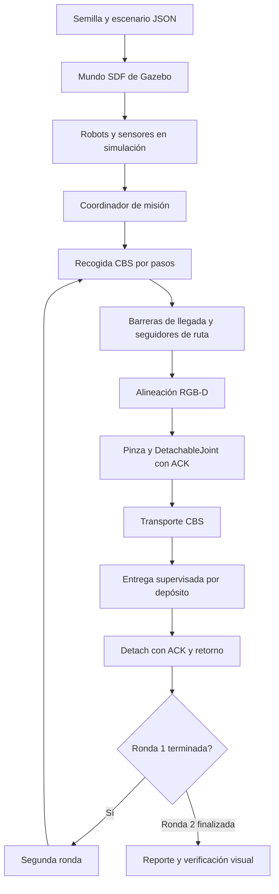

# SwarmBots — arquitectura de la misión CBS

> Documento complementario de `mission_cbs_v1.md`. No reemplaza los README existentes ni describe todas las modalidades del proyecto (por ejemplo, teleoperación o entrenamiento ACT).

## Entorno ROS 2

Siete paquetes presentes en el workspace:

- `robotnik_common`
- `swarm_description`
- `swarm_behavior`
- `summit_xl_description`
- `robotnik_sensors`
- `summit_xl_control`
- `swarm_worlds`

Plataforma demostrada: ROS 2 Jazzy en Ubuntu 24.04, Gazebo Harmonic y contenedor Docker `swarm_dev`.

## Secuencia lógica de misión



El gráfico expresa la secuencia conceptual. La estructura exacta de tópicos, los nombres de nodos y las reglas internas de asignación deben contrastarse con los launch y ejecutores vigentes antes de elaborar una especificación de interfaces.

## Planificación y ejecución

CBS coordina rutas discretas de varios agentes sobre un grafo. El ejecutor de recogida avanza por pasos sincronizados; una barrera requiere verificar la llegada de los robots antes de pasar al siguiente paso. Los reenvíos limitados introducidos en el ejecutor V3 buscan recuperar mensajes de waypoint no aceptados o perdidos, sin adelantar robots al siguiente paso.

Tras la llegada, el control local realiza preorientación y aproximación RGB-D. `grasp_manager` envía órdenes Gazebo de `attach`/`detach` y no debe declarar agarre confirmado sin evidencia del estado del joint. En los fallos por ausencia de ACK se requiere inspección; no se permite continuar ciegamente.

## Cómo identificar la versión estable

```bash
git show --no-patch --oneline swarmbots-physical-v1.0
git status --short
```

Commit de referencia: `1ae53a0`. La rama de documentación `docs/swarmbots-v1` es una rama de trabajo y no debe confundirse con la etiqueta de código estable.

## Trabajo futuro documentado, no implementado aquí

Medir tiempos desglosados por fase, desplazamiento físico odométrico, validación geométrica automática de basura dentro de cada depósito y repeticiones con configuración congelada.
